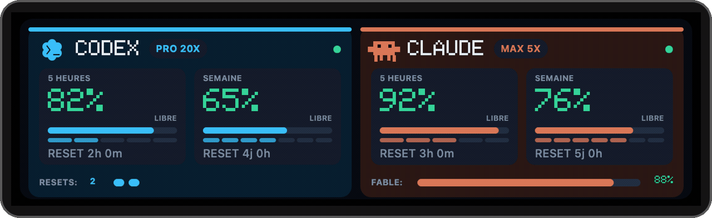
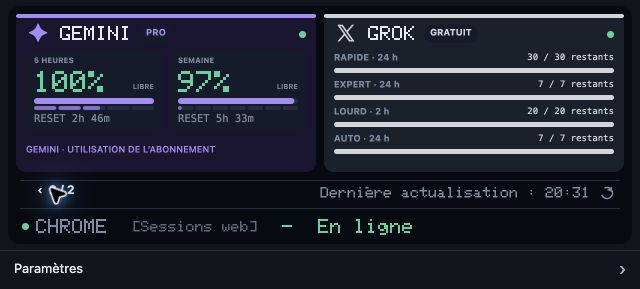

# Quota Display

Suivez les quotas de **Codex**, **Claude**, **Google Gemini** et **Grok** depuis Chrome,
la barre de menus du Mac ou un mini-écran tactile LILYGO T-Display S3 Long. La flèche
du tableau de bord permet de passer de Codex et Claude à Gemini et Grok.

**Chrome peut fonctionner seul.** Connectez les services voulus, puis fermez leurs
onglets. L’extension actualise les quotas toutes les cinq minutes tant que Chrome
fonctionne. Vous pouvez aussi la relier à un Companion Mac qui alimente vos mini-écrans.

[Guide du Designer : démarrage, modèles, connexions et dépannage](https://pducharme.github.io/codex-claude-quota-display/)

[Télécharger le Companion macOS 1.1.18](https://github.com/pducharme/codex-claude-quota-display/releases/tag/v1.1.18)
· [Télécharger l’extension Chrome 1.2.0](https://github.com/pducharme/codex-claude-quota-display/releases/tag/chrome-v1.2.0)
· [Télécharger le firmware 2026.11.17.2](https://github.com/pducharme/codex-claude-quota-display/releases/tag/firmware-2026.11.17.2)
· [Installer l’extension](#installer-lextension-chrome)
· [Confidentialité de l’extension](chrome-extension/PRIVACY.md)



Les quotas en un coup d’œil, puis le noir pour la nuit :
[réglez l’horaire de veille dans le Companion](#veille-des-mini-écrans).

## Fonctionnalités



- **Gemini** affiche les pourcentages restants sur cinq heures et sur la semaine,
  ainsi que le délai avant chaque remise à zéro lorsque Google le fournit.
- **Grok** affiche le nombre de requêtes restantes sur le total et la durée de la
  limite pour chacun des modes fournis par le compte (Rapide, Expert, Lourd et Auto).
- **Codex et Claude** affichent les quotas restants sur cinq heures et sur la semaine.
- Forfaits Codex et Claude, quotas Fable et resets Codex/Claude en banque lorsque les
  fournisseurs les rendent disponibles.
- Crédits OpenAI Work/Codex, crédits API Claude achetés et crédits API mensuels
  liés aux abonnements ChatGPT et Claude : montant utilisé / accordé en USD et
  expiration (UTC).
- Jauges réelles accompagnées de segments indiquant où la consommation devrait
  théoriquement se situer dans la période.
- Companion natif dans la barre de menus macOS.
- Affichage au choix de Codex ou Claude, avec carte pleine largeur, fenêtre
  permanente, mode toujours au premier plan et pourcentage restant dans la
  barre des menus.
- Mode source locale ou client d’une autre instance Quota Display sur le réseau.
- Extension Chrome avec le même tableau de bord que le Mac, des connexions facultatives par service et une fenêtre permanente.
- Mini-écran tactile avec vue détaillée, météo sur cinq jours et actualisation
  par glissement.
- Veille quotidienne des mini-écrans, avec horaire réglable dans le Companion.
- Actualisation automatique toutes les cinq minutes.
- Relance préventive du LCD toutes les 30 minutes pour récupérer un écran noir
  sans débrancher l’ESP32.
- Mises à jour du Companion avec Sparkle, incluant les notes de version.

## Architecture

En mode autonome, Chrome lit les quotas directement auprès des fournisseurs autorisés dans ce profil.
Pour partager les quotas entre appareils, choisissez un Mac source. Le Companion y lit les sessions
locales et transmet les quotas et crédits aux clients via son API.

```text
Sessions web dans Chrome ──► Extension Chrome autonome

Codex, Claude, Gemini et Grok sur le Mac source
                    │
              Companion Mac
                    │ API locale :8788
                    ├── mini-écrans ESP32
                    ├── autres Companions macOS
                    └── extension Chrome en mode Companion Mac
```

Le projet contient quatre parties :

- `bridge/quota_menu.swift` : Companion macOS natif;
- `bridge/quota_bridge.py` : pont API local;
- `firmware/` : firmware PlatformIO du T-Display S3 Long;
- `chrome-extension/` : Companion Chrome autonome ou client de l’API du Mac source.

Pour Gemini et Grok sur le Mac source, utilisez **Paramètres → API et connexions →
Connexions → Autoriser Gemini/Grok via Chrome…**, après connexion au site dans Chrome.
Sélectionnez le fichier Cookies du profil connecté et autorisez Chrome Safe Storage.
Seuls les cookies du service choisi sont lus en mémoire; seuls les quotas filtrés
sont transmis aux clients. Fermer les onglets est possible. **Déconnecter** retire
l’autorisation et le cache du Companion. Dans Chrome autonome, chaque service
possède son propre bouton **Connecter**.

## Installer le Companion macOS

### Prérequis

- macOS 13 ou une version plus récente;
- Python 3.9 ou plus récent (Python.org, Homebrew ou outils de ligne de commande Apple);
- sur le Mac source, connectez les services à suivre. Pour Gemini et Grok, utilisez le profil Google Chrome de votre choix.

Pour mettre à jour un Companion déjà installé, utilisez **Paramètres → Mises à
jour → Vérifier les mises à jour…**. La version 1.1.18 ajoute la page Gemini et Grok ainsi que leur partage par l’API du Mac source. Le ZIP contient l’application universelle signée Developer ID pour les mises à jour Sparkle.
Les versions antérieures à 1.0.7 restent dirigées vers une installation manuelle
depuis la page de téléchargement.

Pour une première installation avec configuration du pont API, téléchargez le
[paquet 1.1.18](https://github.com/pducharme/codex-claude-quota-display/releases/download/v1.1.18/Quota-Display-1.1.18.pkg),
puis ouvrez-le. Le paquet universel prend en charge Apple Silicon et Intel. Il
installe le Companion et son pont API, puis configure leur démarrage à
l’ouverture de session.

Le paquet n’est pas encore notarié par Apple.
Si macOS le bloque, utilisez **clic droit → Ouvrir** ou autorisez-le dans
**Réglages Système → Confidentialité et sécurité**.

Le paquet vérifie Python avant de modifier l’installation. Si les outils de
ligne de commande Apple sont encore en cours d’installation, attendez la fin,
puis rouvrez le paquet. Leur installation se lance avec `xcode-select --install`.

Après l’installation :

1. Ouvrez **Quota Display** dans la barre de menus.
2. Si vous suivez Codex, vérifiez que Codex.app est connecté avec un compte ChatGPT.
3. Dans **Paramètres → API et connexions → Connexions**, choisissez **Autoriser Claude Desktop…** si vous
   utilisez Claude. macOS peut demander l’accès à `Claude Safe Storage`.
   Choisissez **Toujours autoriser** pour conserver cet accès. Depuis la 1.0.25,
   le Companion garde la même identité de signature entre les versions. Une
   nouvelle autorisation est nécessaire au passage depuis une ancienne signature.
4. Choisissez **Actualiser les quotas**.

Pour les crédits API Claude, ouvrez **Paramètres → API et connexions → Connexions →
Autoriser Claude Console via Chrome…** sur le Mac source. Connectez-vous à la
Console dans le profil Chrome actif et sélectionnez l’organisation concernée.
Dans le sélecteur macOS, choisissez le fichier **Cookies** de ce profil, puis
autorisez **Chrome Safe Storage** si macOS le demande. Une autorisation de lecture
du fichier est conservée sur ce Mac. Le Companion
réutilise uniquement les cookies de session de la Console, en mémoire, pour
relire ses soldes toutes les cinq minutes; il n’enregistre aucun cookie.
Les crédits achetés et les crédits mensuels sont affichés séparément. Le mensuel
indique le montant utilisé / accordé en USD, suivi de sa date d’expiration (UTC).
Les autres crédits promotionnels sont identifiés séparément. Après quinze
minutes sans lecture réussie, le dernier solde est marqué **≈**; reconnectez la
Console si nécessaire. Un solde non fourni reste **—**, jamais un zéro supposé.
Les clients Chrome et les mini-écrans lisent ces valeurs par l’API existante et
nécessitent leurs versions prenant en charge l’affichage des crédits.

Pour les crédits API mensuels OpenAI (Companion 1.1.17 et Chrome 1.0.4), choisissez
**Paramètres → API et connexions → Connexions → Connecter OpenAI Platform…** sur le Mac source. Connectez-vous dans
la fenêtre et sélectionnez l’organisation liée à l’abonnement ChatGPT. La session
reste dans le stockage WebKit local; les montants, dates et l’identifiant de
l’organisation sont transmis aux clients, sans la session. La ligne **API** affiche le montant utilisé / réellement accordé en USD
et l’expiration UTC, séparément des crédits Work/Codex. Le premier versement peut
être proratisé : aucun solde de 200 $ n’est présumé. La page est relue toutes les
cinq minutes; **≈** signale un solde non actualisé depuis quinze minutes et **—**
une donnée inconnue. Ce lecteur dépend de la réponse privée de facturation de
Platform; reconnectez cette fenêtre si la session expire. Les mini-écrans doivent
utiliser le firmware du 17 novembre 2026 ou une version plus récente.

Par défaut, le menu montre seulement le tableau de bord et une ligne
**Paramètres**. Les réglages sont regroupés dans **Affichage** (fournisseurs,
fenêtre permanente et premier plan), **API et
connexions** (source, copie de la configuration, démarrage automatique et
comptes), **Mini-écrans** (veille) et **Mises à jour**. L’actualisation des
quotas, les informations de l’application et la commande pour quitter restent
directement accessibles dans **Paramètres**.

Dans **Paramètres → Barre de menus**, choisissez les fournisseurs, les icônes
et les limites à afficher pour chacun : **5 h**, **hebdomadaire** et, pour Claude,
**Fable uniquement**. Plusieurs limites peuvent être cochées; elles apparaissent
dans cet ordre et leur nom est précisé au survol. Ces choix sont propres à ce Mac
et indépendants de l’affichage des cartes et des mini-écrans.

La barre reste monochrome, avec des icônes de 16 points et une largeur ajustée au
contenu. Le séparateur reste visible lorsque les deux fournisseurs sont affichés.

## Utiliser une source distante

Une seule installation peut servir plusieurs mini-écrans et Companions :

1. Sur le Mac source, connectez les services à suivre dans **Paramètres → API et connexions → Connexions**.
2. Choisissez **Copier la configuration API**.
3. Sur chaque Companion client, ouvrez **Source des quotas…**, puis saisissez
   l’adresse et le jeton copiés.
4. Utilisez la même adresse et le même jeton dans le portail de configuration
   des mini-écrans.

Sur le Mac source, **Paramètres → API et connexions → Clé API de ce Mac…**
permet de modifier la clé servie ou de restaurer une ancienne clé après une
réinstallation. Le changement prend effet immédiatement. Tous ses clients
doivent utiliser cette même clé. **Copier la configuration API** reste disponible
sur un Companion client même lorsque la source est hors ligne ou refuse sa clé.

En mode distant, les connexions aux fournisseurs sont gérées uniquement par le
Mac source. Le pont du Mac client reste disponible, mais ne lance plus de
lectures locales des fournisseurs tant qu’une source distante est configurée.
L’action **Actualiser les quotas** du client demande une nouvelle lecture à cette source. Le choix des fournisseurs affichés est aussi enregistré
sur la source : tous les Companions et mini-écrans adoptent le même affichage.

## Installer l’extension Chrome

L’extension 1.2.0 reprend les deux pages du Companion, les forfaits, les crédits
API et le détail des resets en banque. La flèche sous les cartes change de page.
Vous pouvez aussi ouvrir une fenêtre permanente et choisir un quota Codex ou Claude pour le badge Chrome.

1. Téléchargez et décompressez le [ZIP Chrome 1.2.0](https://github.com/pducharme/codex-claude-quota-display/releases/download/chrome-v1.2.0/Quota-Display-Chrome-1.2.0.zip).
2. Ouvrez `chrome://extensions`, activez **Mode développeur**, choisissez **Charger l’extension non empaquetée** et sélectionnez le dossier qui contient `manifest.json`.
3. Épinglez **Quota Display — Companion**, ouvrez son icône, puis **Paramètres → API et connexions → Source des quotas**.

**Sessions web — sans Mac.** Choisissez **Connecter** pour chaque service voulu.
Chrome demande l’accès à ce site. Connectez-vous si nécessaire et attendez
**À jour**. Vous pouvez ensuite fermer les onglets. Les quotas sont relus en
arrière-plan toutes les cinq minutes. Les crédits API OpenAI et Claude ont chacun
leur propre connexion. Les choix d’affichage sont propres à ce profil Chrome.

**Companion Mac.** Sur le Mac source, utilisez **Paramètres → API et connexions →
Copier la configuration API**. Dans l’extension, choisissez **Companion Mac**,
collez la configuration et cliquez sur **Enregistrer et connecter**. Le Mac doit
être joignable sur votre réseau ou VPN. Il fournit alors les mêmes valeurs à
Chrome et aux mini-écrans, y compris Gemini et Grok à partir du Companion 1.1.18.

Le ZIP GitHub permet l’installation manuelle. La distribution par le Chrome Web Store
suit le processus de validation de Google. Les autorisations et le stockage des
sessions sont détaillés dans la [politique de confidentialité](chrome-extension/PRIVACY.md).

## Designer

**Paramètres → Mini-écrans → Designer…** ouvre l'éditeur de pages : six polices,
modèles Quotas/Météo/Horloge/Focus, composition libre et suivi des avions à
proximité avec bascule automatique. Une première mise à jour du firmware est
requise; les publications de pages suivantes passent par HTTP. La version 1.1.8
ajoute une page Avion animée et une durée d’alerte réglable, de 0,1 seconde à
24 heures, avec 3 secondes par défaut. Après installation du firmware associé,
ce réglage se transmet par Wi-Fi, sans nouveau flash.

Consultez le [guide du Designer et son état de validation](docs/designer-v1.md).
Le firmware de la [release 1.1.8](https://github.com/pducharme/codex-claude-quota-display/releases/tag/v1.1.8)
a été installé sur un écran de référence, avec tactile, connexion et composition
confirmés. La validation du deuxième écran et des intégrations avec les comptes
réels reste distincte. Le rendu spécial Avion est intégré au firmware.

## Installer le mini-écran

Matériel pris en charge : **LILYGO T-Display S3 Long**, écran 180×640 utilisé en
mode paysage. Le firmware prend en charge le contrôleur tactile CST3530 des
révisions actuelles.

### Firmware précompilé

La [release firmware 2026.11.17.2](https://github.com/pducharme/codex-claude-quota-display/releases/tag/firmware-2026.11.17.2)
contient les deux images et leurs empreintes SHA-256. Pour afficher Gemini et Grok,
utilisez le Companion 1.1.18 ou plus récent et autorisez les deux services sur le Mac source.
L’écran reçoit les quotas par Wi-Fi.

Pour une première installation, téléchargez cette
[image complète `quota-display-gemini-grok-2026.11.17.2-full.bin`](https://github.com/pducharme/codex-claude-quota-display/releases/download/firmware-2026.11.17.2/quota-display-gemini-grok-2026.11.17.2-full.bin)
et écrivez-la à l’adresse `0x0` depuis le dossier de téléchargement :

```sh
python3 -m venv .venv
. .venv/bin/activate
python -m pip install esptool
SERIAL_PORT=/dev/cu.usbmodemXXXX
python -m esptool --chip esp32s3 --port "$SERIAL_PORT" \
  write_flash 0x0 quota-display-gemini-grok-2026.11.17.2-full.bin
```

Remplacez la valeur de `SERIAL_PORT` par le port USB détecté sur votre
ordinateur.

Pour **mettre à jour un écran déjà configuré**, utilisez uniquement l’image
application à `0x10000` afin de conserver le Wi-Fi, la clé et l’horaire de veille :

```sh
python -m esptool --chip esp32s3 --port "$SERIAL_PORT" \
  write_flash 0x10000 quota-display-gemini-grok-2026.11.17.2-app.bin
```

N’utilisez pas l’image complète à `0x0` pour cette mise à jour : elle recouvre
aussi la zone des réglages.

### Compilation depuis les sources

```sh
python3 -m venv .venv
. .venv/bin/activate
python -m pip install platformio
SERIAL_PORT=/dev/cu.usbmodemXXXX
cd firmware
pio run
pio run --target upload --upload-port "$SERIAL_PORT"
```

### Configuration Wi-Fi

Au premier démarrage, l’écran crée un réseau nommé `QuotaDisplay-XXXXXX`. Le
mot de passe temporaire est affiché sur le LCD.

1. Connectez un téléphone ou un ordinateur à ce réseau.
2. Ouvrez `http://192.168.4.1`.
3. Saisissez le Wi-Fi local, l’adresse du Companion source, le jeton API et la
   ville utilisée pour la météo.
4. Enregistrez. L’écran redémarre et commence sa synchronisation.

### Modifier l’adresse de l’API ou sa clé

Aucun accès aux boutons du boîtier n’est nécessaire :

1. Maintenez le doigt **deux secondes sur l’écran tactile**, même pendant la veille.
2. L’écran affiche son adresse web et un code temporaire.
3. Depuis un téléphone ou un ordinateur sur le **même Wi-Fi**, ouvrez cette
   adresse. Connectez-vous avec **admin** et le code affiché sur l’écran.
4. Modifiez **Adresse de l’API** et/ou **Clé API**, puis choisissez
   **Enregistrer et redémarrer**.

Le Wi-Fi et la ville restent configurés. Laissez la clé vide pour conserver
la clé actuelle; elle n’est jamais renvoyée dans la page. La section **Wi-Fi et
météo** permet aussi de modifier ces réglages. Un mot de passe Wi-Fi vide
conserve celui du même réseau, sauf si **Ce réseau Wi-Fi n’a pas de mot de passe**
est coché.

L’accès expire après cinq minutes ou lorsque vous touchez à nouveau l’écran.
Les quotas sont en pause pendant l’affichage du code. Le code ne dépend pas de
l’ancienne clé API : vous pouvez donc remplacer une clé devenue invalide.
La page utilise HTTP et doit rester sur un réseau de confiance.

Cette fonction nécessite une première mise à jour du firmware par USB sur
chaque écran déjà installé; ensuite, les réglages se modifient par le Web.
Si le Wi-Fi est inaccessible au démarrage, le réseau `QuotaDisplay-XXXXXX`
s’ouvre automatiquement et conserve les réglages pour les corriger. Le maintien
de **BOOT** pendant trois secondes au démarrage reste un accès de secours au
portail, sans effacement préalable.

## Utilisation du mini-écran

- Touchez la carte Codex ou Claude pour consulter les resets en banque et leur expiration.
  Le Companion offre la même vue au clic. Les resets Claude sont lus depuis le
  compte Claude Desktop autorisé sur le Mac source; une lecture indisponible
  affiche `—`, jamais un faux zéro. Cette vue ne consomme aucun reset.
- Depuis Codex et Claude, touchez la flèche en bas à droite ou glissez vers la gauche pour afficher Gemini et Grok. La flèche en bas à gauche ramène à Codex et Claude. Un autre glissement vers la gauche mène à la météo dans la disposition par défaut.
- Tirez brièvement depuis le bord supérieur pour forcer une actualisation
  Codex et Claude sur la source.
- Un point vert indique une lecture valide, orange une dernière valeur conservée
  et rouge une source indisponible.
- Lorsqu’un fournisseur est masqué ou indisponible, l’autre occupe
  automatiquement toute la largeur, sans reflash.
- Lorsqu’une limite 5 h n’est pas fournie, sa section disparaît et la semaine
  occupe toute la largeur de la carte. Une valeur fournie à 0 % reste affichée.
- `NON FOURNI` signifie que le fournisseur n’a pas retourné cette fenêtre de
  quota; l’application n’invente alors aucune valeur.

## Veille des mini-écrans

Dans **Paramètres → Mini-écrans → Veille des mini-écrans…**, activez la veille puis choisissez
l’heure d’extinction et de réveil (23:00–07:00 proposé). Elle est désactivée
par défaut et s’applique à tous les mini-écrans liés à la source sélectionnée.
Les heures suivent le fuseau indiqué dans la fenêtre, y compris les changements
d’heure. Les deux heures doivent être différentes.

Le Companion source et le firmware des écrans doivent être mis à jour une
première fois. Ensuite, les changements d’horaire arrivent par la synchronisation
habituelle, sans reflash. Chaque écran conserve l’horaire en mémoire et l’exécute
même si le Mac dort ou si la source est temporairement indisponible.

Pendant la veille, le rétroéclairage est éteint, le LCD est au repos et les
animations, gestes et relances préventives du LCD sont suspendus. La connexion
reste active pour recevoir les modifications. Le réveil est automatique; pour
réveiller les écrans plus tôt, désactivez la veille dans le Companion.
Après une coupure d’alimentation, l’écran attend une heure valide fournie par
la source ou par NTP avant d’appliquer l’horaire.

## API locale

Le pont écoute par défaut sur le port `8788` et actualise les fournisseurs
toutes les cinq minutes.

| Méthode | Endpoint | Authentification | Rôle |
| --- | --- | --- | --- |
| `GET` | `/health` | Non | État du pont |
| `GET` | `/v1/quotas` | Jeton Bearer | Quotas et état des fournisseurs |
| `GET` | `/v1/weather?city=<ville>` | Jeton Bearer | Conditions et prévisions météo |
| `POST` | `/v1/refresh` | Jeton Bearer | Nouvelle lecture des fournisseurs |
| `POST` | `/v1/display` | Jeton Bearer | Fournisseurs visibles et horaire de veille des mini-écrans |

L’adresse et le jeton se copient depuis **Copier la configuration API** dans le
Companion.

Le pont utilise HTTP sur le réseau local. Ne redirigez pas le port `8788` vers
Internet; utilisez un réseau de confiance ou un VPN. Les jetons OpenAI et
Anthropic ne sont jamais envoyés aux écrans ni aux Companions clients.

## Diagnostic des actualisations

À partir de la version 1.0.23, le Companion et le pont source signalent leurs
échecs d’actualisation à GlitchTip : type d’erreur, code HTTP ou système,
version de l’application et de macOS/Python, mode local ou distant, temps
écoulé depuis la dernière lecture et identifiant aléatoire de session.
À partir de la version 1.1.12, un refus de lecture peut aussi inclure un contexte
`provider_failure` : étape (`initialize` ou `quota_read`), transport, méthode
JSON-RPC autorisée, code JSON-RPC autorisé ou statut HTTP réel, et catégorie
de cause filtrée. Une cause non reconnue reste `unknown`; aucun statut HTTP
n’est déduit du texte d’un refus JSON-RPC local. Les messages et données bruts
du fournisseur ne sont pas joints au diagnostic.
Les erreurs du pont incluent les noms des fichiers/fonctions concernés, sans
chemin personnel ni variables locales.

Aucun jeton, compte, adresse de source, pourcentage de quota, contenu de
conversation ou sortie brute des fournisseurs n’est transmis. GlitchTip tronque l’adresse IP de connexion avant de l’associer
à l’événement. Une même erreur est limitée
à un envoi par quinze minutes et par processus. Les envois se font en arrière-plan;
un échec de GlitchTip n’interrompt pas l’actualisation.

Décochez **Paramètres → Partager les erreurs techniques** pour désactiver
l’envoi du Companion et du pont sur ce Mac. En mode distant, ce réglage doit
être désactivé séparément sur le Mac source. Pour un pont sans Companion,
créez le fichier vide
`~/Library/Application Support/Quota Display/diagnostics-disabled`.

Le choix de désactivation et la limitation de fréquence s’appliquent également
à ces nouveaux champs. Les envois échoués ne sont pas conservés dans une file
sur disque : le diagnostic ne garantit pas l’enregistrement de chaque incident.

La collecte commence après la mise à jour; elle ne récupère pas les erreurs
anciennes. Mettez aussi à jour le Mac source lorsqu’il est distinct du client.
Les mini-écrans n’envoient pas de diagnostic directement.

## Développement

L’installation depuis les sources nécessite les outils de ligne de commande
Xcode :

```sh
cd bridge
./install.sh
```

Vérifications principales :

```sh
python3 bridge/test_quota_bridge.py
python3 bridge/test_installer.py
python3 firmware/test_status_led.py
c++ -std=c++11 -Wall -Wextra -pedantic firmware/test_configuration.cpp -o /tmp/quota-configuration-test
/tmp/quota-configuration-test
c++ -std=c++11 -Wall -Wextra -pedantic firmware/test_sleep.cpp -o /tmp/quota-sleep-test
/tmp/quota-sleep-test
python3 bridge/quota_bridge.py --once
```

Pour construire une Release, créez d’abord
`release-notes/<version>.html`, puis lancez :

```sh
bridge/build_pkg.sh 1.2.3
bridge/generate_appcast.sh 1.2.3
```

Le script de construction compile le Companion pour `arm64` et `x86_64`,
valide sa signature et exécute son autotest natif. La clé privée correspondant
à `bridge/QuotaDisplay-Signing.cer` doit être présente dans le trousseau du
responsable des releases. Le certificat public est versionné; la clé privée
reste dans le trousseau et ne doit pas être remplacée à chaque version.

La signature Apple Developer ID stabilise les autorisations du trousseau. Le test
`python3 bridge/test_signing.py` vérifie qu’une deuxième version conserve
l’accès à un élément synthétique et qu’un binaire non autorisé reste refusé.

## Avis

Quota Display est un projet indépendant, sans affiliation avec OpenAI,
Anthropic, Google, xAI ou LILYGO. Les noms et marques appartiennent à leurs propriétaires
respectifs. Les intégrations reposent sur les sessions locales des applications
et peuvent nécessiter une adaptation si leurs interfaces changent.

Pour Claude, le pont privilégie le cache récent du Companion connecté à
Claude Desktop. En son absence, il lit les quotas JSON avec la session Claude
Code conservée dans le trousseau. Il n’exécute pas de requête de modèle et ne
renouvelle pas les jetons des autres applications. Une session expirée doit
être renouvelée dans Claude Code ou Claude Desktop. Les fenêtres absentes ne reçoivent aucune valeur inventée;
la section 5 h disparaît lorsqu’elle n’est pas fournie.

Consultez aussi [`THIRD_PARTY_NOTICES.md`](THIRD_PARTY_NOTICES.md), le
[dépôt matériel LilyGO](https://github.com/Xinyuan-LilyGO/T-Display-S3-Long)
et la [documentation Open-Meteo](https://open-meteo.com/en/docs).
